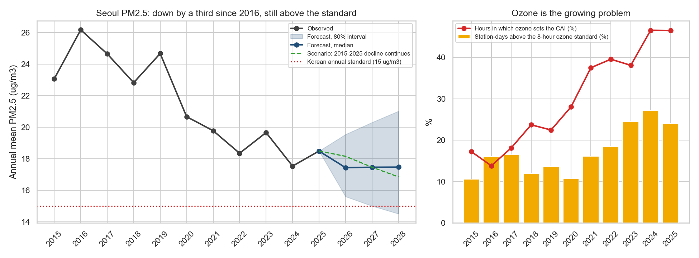

# Seoul Air Quality, 2015-2025: Is the Air Getting Better, and for Whom?

[](https://github.com/moliiner/air_pollution_analysis_seoul/actions/workflows/ci.yml)
[](LICENSE)

End-to-end analysis of the official hourly air pollution readings (PM2.5, PM10, O3, NO2, CO, SO2) of the 25 urban stations of Seoul from 2015 to 2025, validated against the official statistics and joined with hourly weather: long-term trends with uncertainty, seasons, ozone, the Korean air quality index (CAI), population-weighted exposure, a check of each station's level over time, weather-normalised trends with an evaluation of the PM seasonal management system, a 1-3 day PM2.5 forecast issued at 17:00 KST, and a monthly and annual outlook for 2026-2028.

## Executive summary

Seoul's fine dust (PM2.5) fell by about a third, from 26.2 ug/m3 in 2016 to 17.5 in 2024, a trend of -3.53% per year that holds once the weather is removed (-3.24% per year), but the city is still above the Korean annual standard of 15 ug/m3 and **the outlook for 2026-2028 is a plateau, not compliance**: the forecast annual mean is 17.43 ug/m3 in 2026, with a chance of meeting the standard of 0.09 in 2026 and 0.21 in 2028. Ozone moves the other way and now sets the air quality index in 46.5% of the station-hours of 2025. A forecast issued at 17:00 KST with open data and archived weather forecasts cuts the next-day error by 40.0% against persistence. The winters of the PM seasonal management system are cleaner, but so is the rest of the year, so the data cannot credit the system with an effect of its own.



*Left: observed annual PM2.5, the 2026-2028 forecast (median and 80% interval) and a scenario in which the 2015-2025 decline continues. Right: ozone exceedances and the share of hours in which ozone sets the CAI. Made by [notebook 06](notebooks/06_insights_summary.ipynb), which summarises the project for a non-technical reader.*

## Key results

- **PM2.5 fell by about a third, and the decline is robust.** The mean station-day PM2.5 went from 26.2 ug/m3 in 2016 to 17.5 in 2024 (18.5 in 2025), still above the Korean annual standard of 15. The deseasonalised trend is -3.53% per year (95% interval -4.54% to -2.52%, block bootstrap of 12-month blocks), and all 25 stations decline. NO2 (-6.13% a year) and SO2 (-7.72%) fall faster.
- **Weather explains the day, not the decade; winters under the PM seasonal management system (미세먼지 계절관리제) are lower, but not more than the rest of the year.** A gradient boosting model validated by leaving each year out explains daily PM2.5 with R2 0.479 (0.069 with the date alone). With the weather removed, the trend is -3.24% per year (95% interval -4.09% to -2.35%), close to the observed one. Weather-normalised PM2.5 in the six December-March seasons since December 2019 is 5.50 ug/m3 lower than in the four before, and 2.70 ug/m3 below the earlier trend (interval -5.21 to -0.44). But April-November, which the system does not cover, fell almost as much (difference in differences -0.89 ug/m3, p = 0.405), and the gap from the trend loses its significance without the COVID-19 seasons. Seoul declined faster than the Baengnyeong regional background in 2018-2024 (-4.13% against -2.07% a year). These are associations: the system started nationwide together with COVID-19 and other measures ([notebook 09](notebooks/09_weather_normalisation_policy.ipynb)).
- **Ozone is the growing problem.** O3 rises by 3.85% a year (interval 3.10% to 4.62%). Station-days above the 8-hour ozone standard went from 10.6% in 2015 to 27.2% in 2024, and ozone now sets the Korean air quality index (CAI) in 46.5% of the station-hours of 2025, against 17.2% in 2015.
- **Season and day matter far more than district.** The day accounts for 94.4% of the variance of station-day PM2.5, the calendar month for 15.7% and the district for 0.3%. The median daily PM2.5 peaks in March (27.0 ug/m3) and is lowest in September (10.2); in March 31.9% of station-days are graded Bad or Very bad, against 1.9% in August. Multi-day Bad episodes fell from 18 in 2016 to 6 in 2024.
- **Districts cannot be ranked reliably.** The district medians are within 2.5 ug/m3 of each other and their order changes from year to year (Spearman between years: median 0.19). 11 of the 25 stations were relocated or show a level shift, and only 4 keep a consistent difference from the rest of the city. Weighting by the official district population changes the city's PM2.5 by at most 0.165 ug/m3.
- **Roadside air is worse for NO2.** The project's stations are all urban; the 15 roadside stations of Seoul recorded 41.2% more NO2 than the urban ones in 2024.
- **1-3 day forecast issued at 17:00 KST (2015-2025).** Using only data published before 17:00 and archived JMA weather forecasts made at least a day earlier, a ridge regression chosen on the validation years 2020-2021 has a test MAE (2022-2025, one origin per year) of 5.078, 6.004 and 6.200 ug/m3 at D+1, D+2 and D+3: 40.0% lower than persistence at D+1 (95% interval 36.6% to 43.0%) and 44.0% lower than climatology. Without the weather forecast the D+1 MAE is 6.036; Baengnyeong adds little and CAMS (archived only from 2022) makes it worse. For Bad-or-worse days at D+1, a classifier has a POD of 0.516 and a FAR of 0.357, against 0.352 and 0.650 for persistence; a calibrated 80% interval covers 0.850 of the test days ([notebook 10](notebooks/10_forecast_1_3_days.ipynb)).
- **Outlook for 2026-2028 (no shocks anticipated).** Five monthly models were compared on 14 rolling origins up to 36 months ahead with MASE and interval coverage; a rule fixed in advance chose ETS (MASE 0.663, 80% interval coverage 0.835); the model on the weather-normalised series did not do better (0.710). The forecast keeps the annual mean near 17.4 ug/m3 (median 17.46 in 2028, 80% interval 14.5-21.01), with about 24 Bad-or-worse days a year. The chance of meeting the annual standard of 15 ug/m3 is 0.09 in 2026 and 0.21 in 2028; in a scenario where the 2015-2025 decline continues it stays at most 0.01, because the starting level is too high ([notebook 11](notebooks/11_long_term_forecast.ipynb)).
- **Official data 2015-2025 reproduces the official statistics.** The extended series built from the Seoul Open Data Plaza matches 86.4% of 66 official station-year means exactly after rounding and 98.5% within 1 ug/m3; its whole-Seoul PM2.5 mean for 2024 is 17.55 ug/m3 against the official 17.6. For PM, the provisional files equal the AirKorea final data of 2024.
- **Weather 2015-2025.** Hourly ERA5 weather (wind, rain, humidity, temperature, boundary layer height) is joined to every station-day; it follows the Seoul station closely for temperature (correlation 0.993) and less for wind speed (0.671). Same-day associations with city PM2.5 are strongest for the boundary layer height (Spearman -0.39) and wind speed (-0.29). Observed weather is used for analysis only, never as known in advance in a forecast.

**Earlier work on the Kaggle data (2017-2019)**, where the project started:

- **Next-day forecast (Kaggle data, 2017-2019).** A Ridge model chosen on four quarterly validation folds of 2018 has a 2019 MAE 10.0% lower than "tomorrow = today" (7.97 vs 8.86 ug/m3; 95% interval of the gain 4.3% to 15.6%, resampling weeks). As an alert for Bad days it misses more of them than persistence with the grade rule (recall 0.53 vs 0.61); with a threshold calibrated on 2018 (29 ug/m3) its recall rises to 0.76, no longer distinguishable from persistence. 2019 had been inspected before, so these are not untouched test results (see below).
- **Data quality (Kaggle files, notebook 01).** 2.81% of the readings carry a non-normal instrument status and were dropped; all 1,063 PM2.5 readings above 500 ug/m3 in the ready-made summary file carry such a flag. The filter does not hide real peaks: restoring the flagged readings that look real changes the grade of 83 of 26,247 station-days. The Kaggle file has no daily value on 18 days of 2019, including 9 in a row after the largest episode, so the analysis uses 1,077 valid days; the official file has those days (notebook 07).

## Business question

Is Seoul's air getting better, and why? When and where is it most harmful? How well can PM2.5 be forecast one to three days ahead, and where is it likely to be in the next three years?

## Data

- **Official hourly readings, 2015-2025** (main source): Seoul Open Data Plaza, OA-15526 (2015-2022) and OA-2221 (2023-2025), the 25 urban stations, downloaded by `seoul_air.sources` and validated against the AirKorea final data and the official annual means in [notebook 07](notebooks/07_data_2015_2025.ipynb).
- **Weather**: hourly ERA5 at Seoul through Open-Meteo (notebook 08); archived JMA forecasts through the Open-Meteo Previous Runs API (notebook 10).
- **Regional**: the Baengnyeong Island background station from the AirKorea final data (notebooks 09 and 10); CAMS from August 2022 (notebook 10).
- **Population**: resident registration statistics of the Ministry of the Interior and Safety (notebook 03).
- **Kaggle**, *Air Pollution in Seoul* (`bappekim/air-pollution-in-seoul`), <https://www.kaggle.com/datasets/bappekim/air-pollution-in-seoul>: 3,885,066 hourly readings of 2017-2019 with an instrument status code, used for the cleaning and timestamp checks (notebooks 00-01) and the earlier forecast (notebook 05).
- **Timestamps**: Korean Standard Time, marking the start of each hourly average. Official Korean data label the end of the hour, one hour later; notebook 01 verifies the offset against the Seoul Open API.
- Raw and processed files are not committed; the notebooks download them. Sources, licences and changes of methodology: [data/README.md](data/README.md).

## Methodology

| Notebook | Content |
|---|---|
| [00 Data acquisition](notebooks/00_data_acquisition.ipynb) | Download of the Kaggle files and inventory |
| [01 Data cleaning](notebooks/01_data_cleaning.ipynb) | Instrument-status filter, complete hourly grid, daily means (18 of 24 hours), Korean PM grades, timestamp checks |
| [02 Temporal analysis](notebooks/02_eda_temporal.ipynb) | 2015-2025: annual levels, long-term trends with block-bootstrap intervals (all pollutants and each station), seasons, weekday and hourly cycles, ozone against the Korean standards |
| [03 Spatial analysis](notebooks/03_eda_spatial.ipynb) | 2015-2025: variance decomposition, station offsets over time, official relocations and equipment changes, level shifts, comparison of stations with intervals instead of a ranking, population-weighted exposure, roadside vs urban stations |
| [04 Pollutants, episodes and CAI](notebooks/04_pollutants_and_episodes.ipynb) | 2015-2025: pollutant correlations, PM vs ozone seasons, multi-day episodes, coarse-dust days, the Korean CAI and the pollutant that sets it |
| [05 Forecasting (Kaggle)](notebooks/05_forecasting.ipynb) | Earlier next-day PM2.5 per district: baselines, Ridge, gradient boosting, alert threshold calibrated on validation, weekly block bootstrap |
| [06 Insights summary](notebooks/06_insights_summary.ipynb) | Findings, key figure, recommendations and limitations for a non-technical reader |
| [07 Extended data](notebooks/07_data_2015_2025.ipynb) | Official Seoul data 2015-2025: source comparison, loading, validation against official annual means |
| [08 Weather](notebooks/08_weather_2015_2025.ipynb) | Hourly ERA5 weather 2015-2025: units, KST alignment, missing data, check against the Seoul station, join with pollution |
| [09 Weather normalisation and policy](notebooks/09_weather_normalisation_policy.ipynb) | Gradient boosting weather normalisation validated by year, bootstrap ensemble, seasons of the PM seasonal management system against the earlier trend, April-November and the Baengnyeong background, comparison with published studies |
| [10 Forecast, 1-3 days](notebooks/10_forecast_1_3_days.ipynb) | City daily PM2.5 for D+1 to D+3 issued at 17:00 KST: issue-time inputs, Baengnyeong, archived JMA forecasts, CAMS; ridge and boosting, quantiles with conformal calibration, Bad-or-worse classifier, yearly origins against persistence and climatology, comparison with Lee et al. (2022) |
| [11 Outlook 2026-2028](notebooks/11_long_term_forecast.ipynb) | Monthly and annual PM2.5: seasonal mean, ETS, damped trend, SARIMA and a model on the weather-normalised series, rolling origins up to 36 months, MASE and interval coverage, a selection rule fixed in advance, labelled scenarios, chance of meeting 15 ug/m3 and expected Bad days |

**Forecast protocols.** The 1-3 day forecast (notebook 10) uses only data published before 17:00 KST of the issue day (tested), chooses its inputs, model and thresholds on 2020-2021 and is scored once on 2022-2025 with one origin per year, against persistence and climatology. The outlook (notebook 11) compares five models on rolling origins up to 36 months and chooses one with a rule written before any model was evaluated. Both are documented in the [model card](docs/MODEL_CARD.md).

**The earlier Kaggle forecast (notebook 05).** One row per district and issue day; target = next-day mean PM2.5. Features use only data available at the end of the issue day (pollutants of the day, PM2.5 lags, 7-day mean, city-wide mean and its change, season, station). Fit on 2017-2018 and validated on four expanding-window folds, one forecast origin at the start of each quarter of 2018. Settings, the choice of model (lowest mean validation MAE) and the alert threshold (highest out-of-fold F1) come only from these folds. Metrics: MAE, RMSE, bias, Korean grade accuracy, and precision / recall of Bad-or-worse days, with the same rounding as the grade. 95% intervals resample whole weeks of 2019.

**2019 is not an untouched test.** Its results were inspected in earlier versions of the forecast notebook and in the project review, before this protocol was fixed: the earlier validation left out the first quarter, and the review computed the 2019 errors and recall that motivated these changes. Every choice now comes from 2018, but knowledge of 2019 may have shaped which changes were made, so the 2019 figures are an evaluation after inspection and may be optimistic. Notebook 10 provides the clean test on 2022-2025.

## Limitations

- **Associations, not causes.** COVID-19, the PM seasonal management system (from December 2019), other domestic measures and changes in China overlap in time; notebook 09 compares them but cannot separate them, and there is no untreated comparison region.
- **Stations.** One urban station per district. Station levels are not fully comparable over time: the official history gives the year of relocations and equipment replacements, not the month or the instrument, so the cause of a level shift, such as those of Yeongdeungpo-gu, cannot be confirmed. Some district-months are largely missing (for example Gwanak-gu, September 2019).
- **Weather.** A reanalysis (ERA5) at one grid point, with the boundary layer height missing for the first half of 2024.
- **Forecasts.** The 1-3 day forecast uses ERA5 and the AirKorea final data as stand-ins for real-time observations, JMA forecasts up to a day older than an operational forecaster's, and no chemical transport model forecast (none is archived); CAMS is archived only from August 2022. The outlook extends 2015-2025 and does not anticipate shocks such as new policies, emission changes in Korea or China, pandemics or unusual weather years.
- **Provisional data.** The official Seoul files are provisional; for PM they equal the AirKorea final data of 2024, and the 2025 AirKorea file is itself marked provisional.
- **Kaggle files.** 18 days of 2019 have no valid value for any station, among them 2019-03-09 to 2019-03-17 (the official file has them). They are left missing, the evaluation year covers 347 of 365 days, and a likely 3-day episode in May 2019 is split by one of these gaps.

## Dashboard

A small Streamlit dashboard shows the key results, the 1-3 day forecast scores and the 2026-2028 outlook with its scenarios. It reads only the committed files in `reports/`, so it runs without downloading any data:

```bash
pip install -r requirements-app.txt
streamlit run app/streamlit_app.py
```

## Project structure

```
├── app/                  # Streamlit dashboard (reads reports/ only)
├── data/                 # raw/ (never edited), external/, processed/  (not committed); reference/ (curated tables with a source)
├── notebooks/            # 00-11, run in the order of run.py
├── src/seoul_air/        # sources, cleaning, weather, grades, trends, CAI, ozone, population, weather normalisation, policy comparisons, forecasts
├── tests/                # pytest for src/, the dashboard, and every figure quoted in this README and the model card
├── reports/              # figures/ and metrics/ written by the notebooks
├── docs/                 # ANALYSIS_PLAN.md (roadmap), MODEL_CARD.md (forecasts)
├── tools/                # one-off checks outside the pipeline (AirKorea final data)
├── run.py                # install, lint, test, notebooks, all: works on Windows, macOS and Linux
├── requirements.txt      # direct dependencies, with version ranges
├── constraints.txt       # exact versions that ran the project (Python 3.10)
└── LICENSE               # MIT
```

## How to reproduce

Tested with Python 3.10. The same commands work on Windows, macOS and Linux; `make` is not needed (the Makefile only wraps `run.py`).

```bash
python -m venv .venv
.venv\Scripts\activate          # Windows  (source .venv/bin/activate on macOS/Linux)
python run.py install           # pip install -r requirements.txt -c constraints.txt
python run.py all               # lint, run every notebook in order (they download the data), then the tests
```

Single steps: `python run.py lint`, `python run.py test`, `python run.py notebooks` (or `python run.py notebooks 03` to start from notebook 03). The tests include a check that every figure in **Executive summary**, **Key results** and the model card matches the files in `reports/metrics/`, so the documents cannot drift from the notebooks. The first full run downloads about 2 GB: about 0.5 GB is kept in `data/raw/` (the Kaggle and official Seoul files, weather, CAMS, population), and the eleven yearly AirKorea archives (about 130 MB each) are read in memory and only their background stations are kept in `data/external/`. With the downloads in place, `python run.py all` rebuilt `data/processed/` from an empty folder and ran every notebook and test in about 15 minutes on a laptop; `run.py` limits the threads of the numerical libraries to keep memory use low.

## 한국어 요약

서울시 25개 도시대기측정소의 2015\~2025년 공식 시간별 대기오염 자료(PM2.5, PM10, O3, NO2, CO, SO2)를 분석하고 예측한 프로젝트입니다.

- **자료 검증**: 서울 열린데이터광장 자료를 서울시 공식 연평균과 대조해 검증했고(2024년 PM2.5: 17.55 대 공식 17.6㎍/㎥), 시간별 기상자료(ERA5), 백령도 국가배경농도 측정소, JMA 기상예보와 결합했습니다.
- **추세**: 초미세먼지(PM2.5)는 연 3.53%씩 감소했고(95% 구간 2.52\~4.54%), 25개 측정소 모두에서 감소했습니다. 기상 영향을 제거해도 감소 추세는 유지됩니다.
- **오존**: 오존은 연 3.85%씩 증가해, 8시간 기준을 넘은 측정소-일의 비율이 2015년 10.6%에서 2024년 27.2%로 늘었고, 2025년에는 통합대기환경지수(CAI)를 결정하는 물질 중 오존의 비중이 46.5%로 가장 컸습니다.
- **시간과 장소**: 전체 분산 중 날짜가 차지하는 비중은 94.4%, 자치구는 0.3%이며, 측정소 이전과 장비 교체의 영향을 배제할 수 없어 자치구 순위는 신뢰하기 어렵습니다. 인구 가중 노출은 단순 평균과 거의 같았습니다.
- **미세먼지 계절관리제**: 기상 영향을 제거한(기상 정규화) PM2.5는 2019년 12월 미세먼지 계절관리제 시행 이후의 계절(12\~3월)에 이전보다 5.50㎍/㎥ 낮았지만, 계절관리제 대상이 아닌 4\~11월에도 비슷하게 감소해 제도 고유의 효과로 단정할 수 없습니다(연관성 분석).
- **1\~3일 예보**: 오후 5시에 발표하는 1\~3일 예보 모델(2015\~2025년 공식 자료, JMA 기상예보 활용)은 2022\~2025년 시험 기간에 내일(D+1) 예보의 MAE를 지속성 기준보다 40.0% 줄였습니다. 이전의 다음 날 예측 모델(Ridge, 2017\~2019년 Kaggle 자료)은 "내일 = 오늘" 기준 모델보다 평균 절대 오차(MAE)를 10.0% 줄였습니다.
- **2026\~2028년 전망**: 연평균은 약 17㎍/㎥대에 머물 것으로 예상되며(ETS, 사전에 정한 규칙으로 선택), 연평균 기준(15㎍/㎥)을 달성할 확률은 2026년 0.09, 2028년 0.21입니다. 이 전망은 정책 변화나 팬데믹 같은 충격을 예측하지 않습니다.
- **한계**: 인과관계가 아닌 연관성 분석이며, 자치구당 측정소 1개, 단일 격자점 기상자료, 실시간 자료 대신 확정·재분석 자료를 사용했습니다. 예측 모델의 상세 내용은 [모델 카드](docs/MODEL_CARD.md)(영문)에 정리했습니다.

## Tech stack

Python, pandas, NumPy, scikit-learn, statsmodels, SciPy, Matplotlib, seaborn, Streamlit, pytest, GitHub Actions.

## License

Code and documentation: [MIT](LICENSE). The data is not part of the repository: the Kaggle dataset is published under CC BY-SA 4.0, and the official Seoul files (OA-15526, OA-2221) are under the Korea Open Government License Type 1, and the reference tables in `data/reference/` come from the Seoul Open Data Plaza, AirKorea and a Seoul Metropolitan Government report, the weather comes from ERA5 (Copernicus licence) through Open-Meteo (CC BY 4.0), the archived JMA forecasts and CAMS also through Open-Meteo (CC BY 4.0; CAMS under the Copernicus licence), and the background stations from the AirKorea final data, kept locally and not redistributed (see [data/README.md](data/README.md)).
