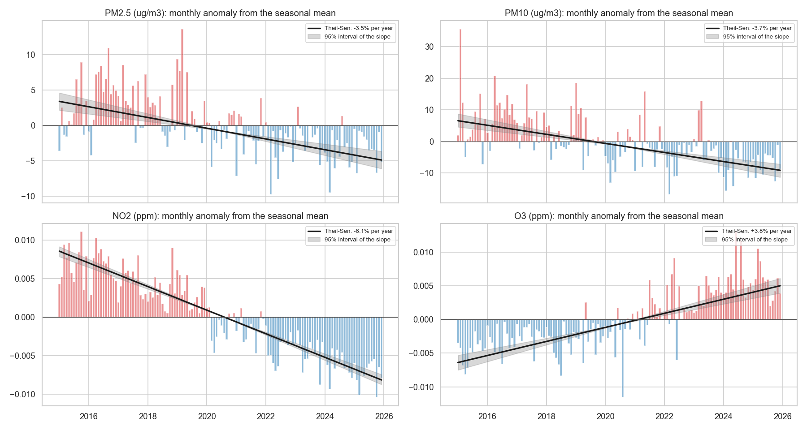

# Seoul Air Quality, 2015-2025: Is the Air Getting Better, and for Whom?

End-to-end analysis of the official hourly air pollution readings (PM2.5, PM10, O3, NO2, CO, SO2) of the 25 urban stations of Seoul from 2015 to 2025, validated against the official statistics and joined with hourly weather: long-term trends with uncertainty, seasons, ozone, the Korean air quality index (CAI), population-weighted exposure, a check of each station's level over time, and a next-day PM2.5 forecast.

> **Status:** notebooks 02-04 and 06-08 use the official data of 2015-2025. The forecast (notebook 05) still uses the Kaggle data of 2017-2019 and is the next part to move (see [docs/ANALYSIS_PLAN.md](docs/ANALYSIS_PLAN.md)). [Notebook 06](notebooks/06_insights_summary.ipynb) summarises the findings for a non-technical reader.

## Key results

- **PM2.5 fell by about a third, and the decline is robust.** The mean station-day PM2.5 went from 26.2 ug/m3 in 2016 to 17.5 in 2024 (18.5 in 2025), still above the Korean annual standard of 15. The deseasonalised trend is -3.53% per year (95% interval -4.54% to -2.52%, block bootstrap of 12-month blocks), and all 25 stations decline. NO2 (-6.13% a year) and SO2 (-7.72%) fall faster.
- **Ozone is the growing problem.** O3 rises by 3.85% a year (interval 3.10% to 4.62%). Station-days above the 8-hour ozone standard went from 10.6% in 2015 to 27.2% in 2024, and ozone now sets the Korean air quality index (CAI) in 46.5% of the station-hours of 2025, against 17.2% in 2015.
- **Season and day matter far more than district.** The day accounts for 94.4% of the variance of station-day PM2.5, the calendar month for 15.7% and the district for 0.3%. The median daily PM2.5 peaks in March (27.0 ug/m3) and is lowest in September (10.2); in March 31.9% of station-days are graded Bad or Very bad, against 1.9% in August. Multi-day Bad episodes fell from 18 in 2016 to 6 in 2024.
- **Districts cannot be ranked reliably.** The district medians are within 2.5 ug/m3 of each other and their order changes from year to year (Spearman between years: median 0.19). 11 of the 25 stations were relocated or show a level shift, and only 4 keep a consistent difference from the rest of the city. Weighting by the official district population changes the city's PM2.5 by at most 0.165 ug/m3.
- **Roadside air is worse for NO2.** The project's stations are all urban; the 15 roadside stations of Seoul recorded 41.2% more NO2 than the urban ones in 2024.
- **Official data 2015-2025 reproduces the official statistics.** The extended series built from the Seoul Open Data Plaza matches 86.4% of 66 official station-year means exactly after rounding and 98.5% within 1 ug/m3; its whole-Seoul PM2.5 mean for 2024 is 17.55 ug/m3 against the official 17.6. For PM, the provisional files equal the AirKorea final data of 2024.
- **Weather 2015-2025.** Hourly ERA5 weather (wind, rain, humidity, temperature, boundary layer height) is joined to every station-day; it follows the Seoul station closely for temperature (correlation 0.993) and less for wind speed (0.671). Same-day associations with city PM2.5 are strongest for the boundary layer height (Spearman -0.39) and wind speed (-0.29). Observed weather is used for analysis only, never as known in advance in a forecast.
- **Next-day forecast (Kaggle data, 2017-2019).** A Ridge model chosen on four quarterly validation folds of 2018 has a 2019 MAE 10.0% lower than "tomorrow = today" (7.97 vs 8.86 ug/m3; 95% interval of the gain 4.3% to 15.6%, resampling weeks). As an alert for Bad days it misses more of them than persistence with the grade rule (recall 0.53 vs 0.61); with a threshold calibrated on 2018 (29 ug/m3) its recall rises to 0.76, no longer distinguishable from persistence. 2019 had been inspected before, so these are not untouched test results (see below).
- **Data quality (Kaggle files, notebook 01).** 2.81% of the readings carry a non-normal instrument status and were dropped; all 1,063 PM2.5 readings above 500 ug/m3 in the ready-made summary file carry such a flag. The filter does not hide real peaks: restoring the flagged readings that look real changes the grade of 83 of 26,247 station-days. The Kaggle file has no daily value on 18 days of 2019, including 9 in a row after the largest episode, so the analysis uses 1,077 valid days; the official file has those days (notebook 07).



## Business question

When and where is Seoul's air most harmful, and can tomorrow's PM2.5 level be predicted well enough to warn residents?

## Data

- **Source:** Kaggle, *Air Pollution in Seoul* (`bappekim/air-pollution-in-seoul`), <https://www.kaggle.com/datasets/bappekim/air-pollution-in-seoul>; according to its description the data comes from the Seoul Metropolitan Government. Check the terms of use on the Kaggle page before reusing it.
- **Content:** 3,885,066 hourly readings (25 stations x 6 pollutants, 2017-01-01 to 2019-12-31) with an instrument status code.
- **Timestamps:** Korean Standard Time, marking the start of each hourly average. Official Korean data label the end of the hour, one hour later; notebook 01 verifies the offset against the Seoul Open API.
- The raw files are not committed; `notebooks/00_data_acquisition.ipynb` downloads them. See [data/README.md](data/README.md).
- **Extended data (2015-2025):** official hourly files of the Seoul Open Data Plaza, OA-15526 (2015-2022) and OA-2221 (2023-2025), downloaded by `seoul_air.sources` and compared with the AirKorea final data and the official annual means in [notebook 07](notebooks/07_data_2015_2025.ipynb). Source comparison and changes of methodology: [data/README.md](data/README.md#extended-source-2015-2025-notebook-07).

## Methodology

| Notebook | Content |
|---|---|
| [00 Data acquisition](notebooks/00_data_acquisition.ipynb) | Download and file inventory |
| [01 Data cleaning](notebooks/01_data_cleaning.ipynb) | Instrument-status filter, complete hourly grid, daily means (18 of 24 hours), Korean PM grades |
| [02 Temporal analysis](notebooks/02_eda_temporal.ipynb) | 2015-2025: annual levels, long-term trends with block-bootstrap intervals (all pollutants and each station), seasons, weekday and hourly cycles, ozone against the Korean standards |
| [03 Spatial analysis](notebooks/03_eda_spatial.ipynb) | 2015-2025: variance decomposition, station offsets over time, official relocations and equipment changes, level shifts, comparison of stations with intervals instead of a ranking, population-weighted exposure, roadside vs urban stations |
| [04 Pollutants, episodes and CAI](notebooks/04_pollutants_and_episodes.ipynb) | 2015-2025: pollutant correlations, PM vs ozone seasons, multi-day episodes, coarse-dust days, the Korean CAI and the pollutant that sets it |
| [05 Forecasting](notebooks/05_forecasting.ipynb) | Next-day PM2.5 per district: baselines, Ridge, gradient boosting, alert threshold calibrated on validation, weekly block bootstrap |
| [06 Insights summary](notebooks/06_insights_summary.ipynb) | Findings, recommendations and limitations for a non-technical reader |
| [07 Extended data](notebooks/07_data_2015_2025.ipynb) | Official Seoul data 2015-2025: source comparison, loading, validation against official annual means |
| [08 Weather](notebooks/08_weather_2015_2025.ipynb) | Hourly ERA5 weather 2015-2025: units, KST alignment, missing data, check against the Seoul station, join with pollution |

**Forecast protocol.** One row per district and issue day; target = next-day mean PM2.5. Features use only data available at the end of the issue day (pollutants of the day, PM2.5 lags, 7-day mean, city-wide mean and its change, season, station). Fit on 2017-2018 and validated on four expanding-window folds, one forecast origin at the start of each quarter of 2018. Settings, the choice of model (lowest mean validation MAE) and the alert threshold (highest out-of-fold F1) come only from these folds. Metrics: MAE, RMSE, bias, Korean grade accuracy, and precision / recall of Bad-or-worse days, with the same rounding as the grade. 95% intervals resample whole weeks of 2019.

**2019 is not an untouched test.** Its results were inspected in earlier versions of the forecast notebook and in the project review, before this protocol was fixed: the earlier validation left out the first quarter, and the review computed the 2019 errors and recall that motivated these changes. Every choice now comes from 2018, but knowledge of 2019 may have shaped which changes were made, so the 2019 figures are an evaluation after inspection and may be optimistic. A clean test needs data from 2020 onward.

## Limitations

- Notebooks 00-06 use no weather data. Hourly weather for 2015-2025 is now available (notebook 08), from a reanalysis at one grid point; its boundary layer height is missing for the first half of 2024.
- Trends are not adjusted for weather, and describe 2015-2025 rather than explain it: they include the COVID-19 period and the PM seasonal management system (from December 2019), whose effects are not separated yet. The forecast still uses three Kaggle years.
- One station per district; some district-months are largely missing (for example Gwanak-gu, September 2019).
- Station levels are not fully comparable over time. The official history gives the year of relocations and equipment replacements, not the month or the instrument, so the cause of a level shift, such as those of Yeongdeungpo-gu, cannot be confirmed.
- In the Kaggle file, 18 days of 2019 have no valid value for any station, among them 2019-03-09 to 2019-03-17 (the official file has them). They are left missing, the evaluation year covers 347 of 365 days, and a likely 3-day episode in May 2019 is split by one of these gaps.

## Project structure

```
├── data/                 # raw/ (never edited), external/, processed/  (not committed); reference/ (official station history)
├── notebooks/            # 00-06, run in order
├── src/seoul_air/        # loading and cleaning, official sources, weather, PM grades, episodes, station levels, forecast, metrics, key figures
├── tests/                # pytest for src/ and for every figure quoted in this README
├── reports/              # figures/ and metrics/ written by the notebooks
├── docs/ANALYSIS_PLAN.md # roadmap and checklists
├── tools/                # one-off checks outside the pipeline (AirKorea final data)
├── run.py                # install, lint, test, notebooks, all: works on Windows, macOS and Linux
├── requirements.txt      # direct dependencies, with version ranges
├── constraints.txt       # exact versions that ran the project (Python 3.10)
└── LICENSE               # MIT
```

## How to reproduce

Tested with Python 3.10. The same commands work on Windows, macOS and Linux; `make` is not needed (the Makefile only wraps `run.py`).

```bash
python -m venv .venv
.venv\Scripts\activate          # Windows  (source .venv/bin/activate on macOS/Linux)
python run.py install           # pip install -r requirements.txt -c constraints.txt
python run.py all               # lint, run every notebook in order (00 and 07 download the data), then the tests
```

Single steps: `python run.py lint`, `python run.py test`, `python run.py notebooks` (or `python run.py notebooks 03` to start from notebook 03). The tests include a check that every figure in **Key results** matches the files in `reports/metrics/`, so the README cannot drift from the notebooks. Notebook 05 takes several minutes; `run.py` limits the threads of the numerical libraries to keep memory use low.

## 한국어 요약

서울시 25개 도시대기측정소의 2015~2025년 공식 시간별 대기오염 자료(PM2.5, PM10, O3, NO2, CO, SO2)를 분석한 프로젝트입니다. 자료는 서울 열린데이터광장에서 내려받아 서울시 공식 연평균과 대조해 검증했고(2024년 PM2.5: 17.55 대 공식 17.6㎍/㎥), 시간별 기상자료(ERA5)와 결합했습니다. 초미세먼지(PM2.5)는 연 3.53%씩 감소했고(95% 구간 2.52~4.54%), 25개 측정소 모두에서 감소했습니다. 반면 오존은 연 3.85%씩 증가해, 8시간 기준을 넘은 측정소-일의 비율이 2015년 10.6%에서 2024년 27.2%로 늘었고, 2025년에는 통합대기환경지수(CAI)를 결정하는 물질 중 오존의 비중이 46.5%로 가장 컸습니다. 전체 분산 중 날짜가 차지하는 비중은 94.4%, 자치구는 0.3%이며, 측정소 이전과 장비 교체의 영향을 배제할 수 없어 자치구 순위는 신뢰하기 어렵습니다. 인구 가중 노출은 단순 평균과 거의 같았습니다. 다음 날 PM2.5 예측 모델(Ridge, 2017~2019년 Kaggle 자료)은 "내일 = 오늘" 기준 모델보다 평균 절대 오차(MAE)를 10.0% 줄였습니다.

## Tech stack

Python, pandas, NumPy, scikit-learn, SciPy, Matplotlib, seaborn, pytest, GitHub Actions.

## License

Code and documentation: [MIT](LICENSE). The data is not part of the repository: the Kaggle dataset is published under CC BY-SA 4.0, and the official Seoul files (OA-15526, OA-2221) are under the Korea Open Government License Type 1, and the reference tables in `data/reference/` come from the Seoul Open Data Plaza, AirKorea and a Seoul Metropolitan Government report, and the weather comes from ERA5 (Copernicus licence) through Open-Meteo (CC BY 4.0) (see [data/README.md](data/README.md)).
