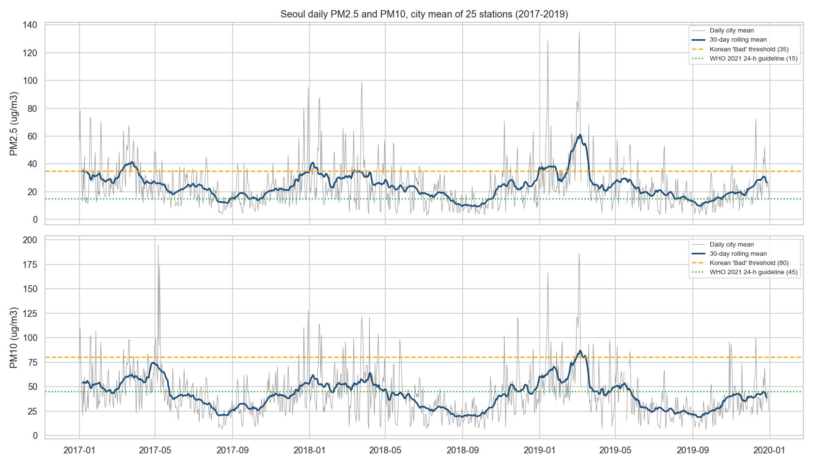

# Seoul Air Quality: When and Where Is the Air Most Harmful?

End-to-end analysis of hourly air pollution readings (PM2.5, PM10, O3, NO2, CO, SO2) from the 25 district stations of Seoul, 2017-2019: status-based data cleaning, temporal and spatial EDA, pollution episodes, and a next-day PM2.5 forecast evaluated against a persistence baseline on a held-out year.

> **Status:** notebooks 00-05 are complete; the non-technical summary (notebook 06) is in progress.

## Key results

- **Season matters far more than district, but daily swings matter most.** The calendar month accounts for 23.4% of the station-day variance of PM2.5 and the district for 0.6%; most of the rest is day-to-day change within the same month. The median daily PM2.5 peaks in March (34.4 ug/m3) and is lowest in September (10.7). In March 48.1% of station-days are graded Bad or Very bad, against 0.4% in August.
- **PM2.5 is a city-wide phenomenon.** Daily PM2.5 correlates at 0.90 or more between any two districts, and the date accounts for 94.3% of the station-day variance.
- **Districts cannot be ranked reliably.** The order of the district medians changes from year to year (Spearman 0.12-0.22), and a station's offset from the rest of the city moves by more over time (typically 6.4 ug/m3) than the gap between the highest and lowest medians (4.7). Four stations were relocated in 2018 and 9 are not comparable across the period; only 5 of 25 keep a consistent difference. Instrument effects are possible but cannot be confirmed: official records give only the year of each change.
- **No detectable trend in 3 years.** The mean station-day PM2.5 was 24.6, 22.8 and 24.9 ug/m3, above the Korean annual standard (15) every year; 48 multi-day Bad episodes were found, almost all in winter and spring.
- **Next-day forecast.** A Ridge model selected on 2018 validation folds cuts the 2019 MAE by 10.0% against "tomorrow = today" (7.97 vs 8.86 ug/m3). It raises fewer false alarms (precision on Bad days 0.70 vs 0.62) but misses more Bad days (recall 0.54 vs 0.61): useful for the level, not yet for alerts.
- **Data quality.** 2.81% of the readings carry a non-normal instrument status and were dropped; all 1,063 PM2.5 readings above 500 ug/m3 in the ready-made summary file carry such a flag. The filter does not hide real peaks: restoring the flagged readings that look real changes the grade of 83 of 26,247 station-days. Seoul has no daily value on 18 days of 2019, including 9 in a row after the largest episode, so the analysis uses 1,077 valid days.



## Business question

When and where is Seoul's air most harmful, and can tomorrow's PM2.5 level be predicted well enough to warn residents?

## Data

- **Source:** Kaggle, *Air Pollution in Seoul* (`bappekim/air-pollution-in-seoul`), <https://www.kaggle.com/datasets/bappekim/air-pollution-in-seoul>; according to its description the data comes from the Seoul Metropolitan Government. Check the terms of use on the Kaggle page before reusing it.
- **Content:** 3,885,066 hourly readings (25 stations x 6 pollutants, 2017-01-01 to 2019-12-31) with an instrument status code.
- The raw files are not committed; `notebooks/00_data_acquisition.ipynb` downloads them. See [data/README.md](data/README.md).

## Methodology

| Notebook | Content |
|---|---|
| [00 Data acquisition](notebooks/00_data_acquisition.ipynb) | Download and file inventory |
| [01 Data cleaning](notebooks/01_data_cleaning.ipynb) | Instrument-status filter, complete hourly grid, daily means (18 of 24 hours), Korean PM grades |
| [02 Temporal EDA](notebooks/02_eda_temporal.ipynb) | Annual level vs Korean and WHO references, seasonality, weekday and hourly cycles |
| [03 Spatial EDA](notebooks/03_eda_spatial.ipynb) | Variance decomposition, station offsets over time, official relocations and equipment changes, level shifts, comparison of stations with intervals instead of a ranking |
| [04 Pollutants and episodes](notebooks/04_pollutants_and_episodes.ipynb) | Pollutant correlations, PM vs ozone seasons, multi-day episodes, coarse-dust days |
| [05 Forecasting](notebooks/05_forecasting.ipynb) | Next-day PM2.5 per district: baselines, Ridge, gradient boosting |
| [06 Insights summary](notebooks/06_insights_summary.ipynb) | Findings for a non-technical reader (in progress) |

**Forecast protocol.** One row per district and issue day; target = next-day mean PM2.5. Features use only data available at the end of the issue day (pollutants of the day, PM2.5 lags, 7-day mean, city-wide mean and its change, season, station). Fit on 2017-2018, settings tuned on three expanding-window folds inside 2018, model chosen on validation MAE, and 2019 used once as the test year. Metrics: MAE, RMSE, bias, Korean grade accuracy and precision / recall of Bad-or-worse days.

## Limitations

- No weather data (wind, rain, humidity), so its role in day-to-day changes cannot be measured.
- Three years only: too short to separate a trend from year-to-year variation, and the seasonal management system introduced in December 2019 cannot be evaluated.
- One station per district; some district-months are largely missing (for example Gwanak-gu, September 2019).
- Station levels are not fully comparable over time. The official history gives the year of relocations and equipment replacements, not the month or the instrument, so the cause of a level shift, such as those of Yeongdeungpo-gu, cannot be confirmed.
- 18 days of 2019 have no valid value for any station, among them 2019-03-09 to 2019-03-17. They are left missing, the test year covers 347 of 365 days, and a likely 3-day episode in May 2019 is split by one of these gaps.

## Project structure

```
├── data/                 # raw/ (never edited), external/, processed/  (not committed); reference/ (official station history)
├── notebooks/            # 00-06, run in order
├── src/seoul_air/        # config, loading and cleaning, PM grades, episodes, station levels, forecast features, metrics
├── tests/                # pytest for src/
├── reports/              # figures/ and metrics/ written by the notebooks
├── docs/ANALYSIS_PLAN.md # roadmap and checklists
├── Makefile              # install, test, lint, notebooks
└── requirements.txt
```

## How to reproduce

```bash
python -m venv .venv
.venv\Scripts\activate          # Windows  (source .venv/bin/activate on macOS/Linux)
pip install -r requirements.txt
pytest -q
make notebooks                  # runs 00-06 in order; 00 downloads the data
```

## 한국어 요약

서울시 25개 자치구 측정소의 2017~2019년 시간별 대기오염 데이터(PM2.5, PM10, O3, NO2, CO, SO2)를 분석한 프로젝트입니다. 측정기 상태 코드를 이용해 이상값을 제거하고, 계절·요일·시간대별 패턴, 자치구 간 차이, 고농도 에피소드를 분석했습니다. 초미세먼지(PM2.5)는 3월에 가장 높고 9월에 가장 낮습니다. 전체 분산 중 달력 월이 차지하는 비중은 23.4%, 자치구는 0.6%이며, 나머지 대부분은 같은 달 안에서 나타나는 일별 변동입니다. 3년 데이터로는 뚜렷한 추세를 확인할 수 없습니다. 측정소 이전과 장비 교체의 영향을 배제할 수 없어 자치구 순위는 신뢰하기 어렵습니다. 다음 날 PM2.5 예측 모델(Ridge)은 2019년 테스트에서 "내일 = 오늘" 기준 모델보다 평균 절대 오차(MAE)를 10.0% 줄였습니다.

## Tech stack

Python, pandas, NumPy, scikit-learn, Matplotlib, seaborn, pytest, GitHub Actions.
